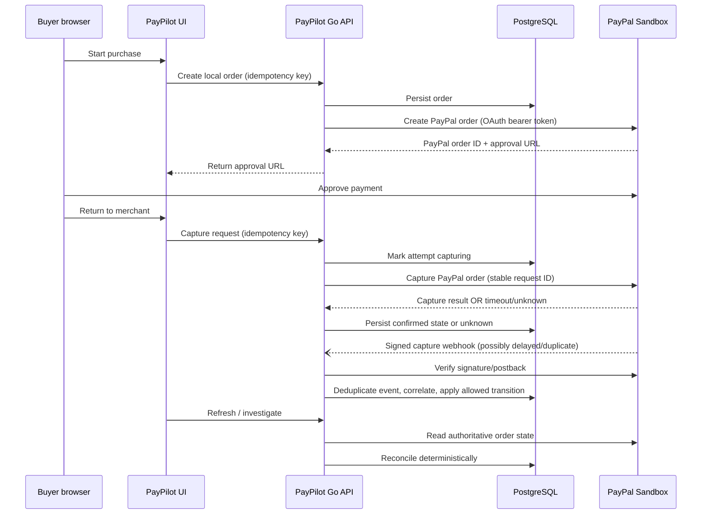
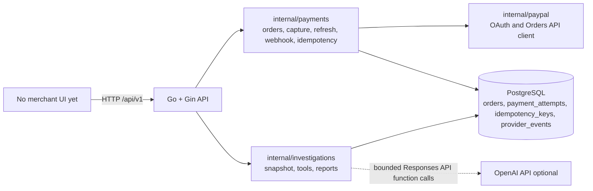
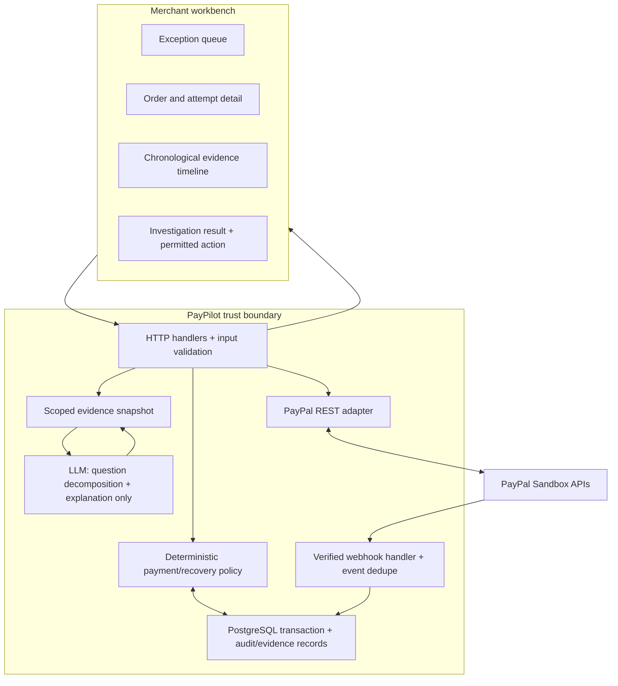

# Architecture today and proposed target

## 1. Architecture vocabulary

- **PayPal platform (public surface):** merchant-facing REST/SDK APIs, OAuth access tokens, Orders v2, capture, webhooks, developer tools, and Sandbox. The internal backend behind these APIs is not public.
- **Merchant application:** PayPilot's own Go API, database, UI, and business rules. It calls PayPal from the server.
- **Agent/LLM:** a probabilistic component that interprets a question and explains evidence. It is not payment authority and must not have direct database or provider credentials.
- **Provider event:** an asynchronous notification PayPal sends to the merchant callback after an event. The app has to verify, deduplicate, persist, and process it.

## 2. PayPal's public payment flow

For the common Orders v2 `CAPTURE` path, the merchant backend creates a PayPal order, the buyer approves on PayPal, and the merchant backend calls capture. The API response includes a status and capture identifiers. The backend should not infer success from the browser redirect alone. PayPal also sends asynchronous webhooks; event verification confirms sender authenticity, not that an unrelated merchant record has been correctly correlated. See [Orders API](https://developer.paypal.com/api/rest/integration/orders-api), [Checkout integration](https://developer.paypal.com/platforms/checkout/standard/integrate), and [webhook verification](https://developer.paypal.com/api/rest/webhooks/rest/).

This is a merchant-side reference flow; exact API details and enabled products depend on the PayPal app/account.

## 3. Current repository architecture (observed)

Main files: `cmd/api/main.go`; `internal/payments/handlers.go`, `idempotency.go`, `webhooks.go`; `internal/paypal/client.go`; `internal/investigations/{handlers,postgres,service,tools,openai}.go`; migrations `001`–`003`.

The last recorded audit found: working API and mocked-provider tests; no completed PostgreSQL runtime flow; no live Sandbox test; no UI; no authentication or tenant isolation; USD/two-decimal assumption. Recheck before claiming current status because code may have changed after that audit.

### Existing persistence concepts

- `orders`: merchant order ID/reference, integer minor-unit amount, currency, local status.
- `payment_attempts`: local order link, PayPal order/capture IDs, amount/currency, attempt status and timestamps.
- `idempotency_keys`: request fingerprint and stored response for mutation replay protection.
- `provider_events`: unique provider event ID, correlation IDs, sanitized payload, processing state.
- `investigations`: question, finding/confidence/recommendation, evidence and report JSON.

The event payload is intended to hold minimal sanitized data, not a raw provider dump. The investigation service loads records and validates evidence IDs. The model's tool catalog is read-only; PayPal payment operations remain in the payment package.

## 4. Proposed target architecture

Keep the current monolith/modules. Add a thin merchant web client and an exception/timeline read model. Do not split microservices for a hackathon. A normalized event projection can be added only as needed to produce a reliable chronological timeline.

**Authority ordering:** verified PayPal API result for provider-side outcome; verified webhook as signed event evidence subject to correlation and order rules; local database as merchant's history; AI text as interpretation only. A webhook should not silently replace provider refresh where current state is required for a high-consequence decision.

## 5. Why not build a generic AI wrapper

The PayPal Agent Toolkit already offers typed actions across payments, invoices, disputes, subscriptions, shipping, catalog, and reporting. A wrapper that simply exposes those actions through chat adds little new value. PayPilot's engineering contribution is a stateful bridge around payment failures: correlation, idempotency, state transitions, event history, evidence-backed diagnosis, and safe recovery. That creates a defined boundary adjacent to agent execution.

## 6. Production gaps (explicitly out of hackathon scope)

- Authenticated merchant identity, role authorization, tenant-scoped database queries, and audit identity.
- Secret manager/token lifecycle, encryption, credential rotation, webhook certificate/signature security review and abuse controls.
- Durable background jobs/reconciliation scheduling, dead-letter/replay tools, retention policy, backups, observability, alerting, SLOs, load/security testing.
- Currency exponent metadata rather than assuming two decimal places.
- Strong migration management and production rollback strategy.
- Privacy/compliance review for logs, merchant/customer data, model provider processing, data retention, and user consent.
- Formal approval record, separation of duties, action policy, idempotent command processing, and audit history.

Do not present this hackathon architecture as production-ready financial infrastructure.
