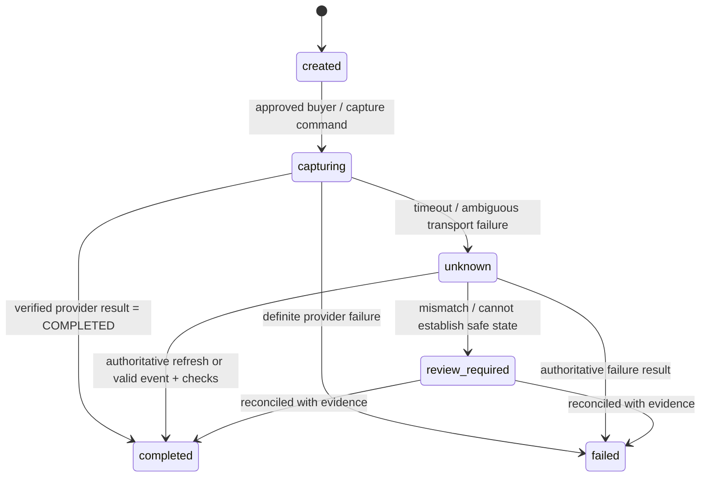

# Payment reliability concepts: why the hard part is state

## Distributed calls can have ambiguous outcomes

When PayPilot calls PayPal's capture endpoint, the network can fail in either direction. PayPal may process the capture and send a response that never reaches PayPilot. From PayPilot's view, the request timed out. That does **not** prove the capture failed.

Naive behavior:

1. Capture call times out.
2. Mark the order failed.
3. Create another capture.
4. The buyer may be charged twice if the first capture succeeded.

Safer behavior:

1. Persist an attempt and move it to `capturing` before the call.
2. If the call returns a definite completed response, persist the capture ID and completion.
3. If the result is uncertain, persist `unknown`/review-required, not failed or paid.
4. Refresh the PayPal order/capture state using the provider API.
5. Correlate webhook events and identifiers.
6. Only let deterministic policy authorize another capture when evidence shows it is safe.

This is a small form of a distributed transaction problem: PayPilot and PayPal do not share one database transaction. A local SQL transaction cannot roll back a remote capture.

## Idempotency

Idempotency is a promise that repeating the same logical request does not cause the mutation to happen twice. A key identifies the operation; a request hash detects accidental reuse of the same key with different content. PayPilot's middleware stores a response, and PayPal APIs support request IDs on applicable calls. These are two separate boundaries: local API replay protection and provider request deduplication. Keep the same stable provider request ID for a retry of the same operation, not a newly generated ID for each network attempt.

Example:

```text
merchant request: POST /payments/{id}/capture
Idempotency-Key: cap_attempt_123
request hash: sha256(payment_id + operation + canonical body)
provider request ID: stable identifier bound to this capture attempt
```

Same key + same body: replay stored result. Same key + different body: reject with conflict. A key is not authorization; access checks must occur separately.

## Webhooks are at-least-once and out of order

Providers retry webhook delivery when acknowledgment fails, so duplicates are normal. A webhook can also arrive before a delayed API response or after a later state. Design for:

- **Authenticity:** verify the message using PayPal's supported signature/postback mechanism before acting.
- **Deduplication:** unique provider event ID and atomic insert; repeated ID is acknowledged but not applied twice.
- **Correlation:** associate event with the correct provider order/capture and local order; don't trust an arbitrary ID match.
- **Monotonicity:** a late `PENDING` event cannot demote a confirmed `COMPLETED` capture.
- **Amount/currency:** check provider event data against expected amount and currency before mutating state.
- **Durability:** persist event before processing; record processing state and failure cause for replay.
- **Acknowledgment:** respond 2xx only once the event is safely durable/handled according to the provider delivery contract.

PayPal's webhook guide says non-2xx deliveries can be retried up to 25 times over three days. The event's valid signature establishes authenticity of its body/headers; it does not establish local business correctness, such as matching the expected amount.

## Reconciliation is a deterministic comparison, not an AI guess

Reconciliation compares independently stored views of one transaction:

| View | Example question |
|---|---|
| Merchant order | Is it `pending`, `paid`, or under review? What amount/currency did the merchant intend? |
| Payment attempts | Were there multiple requests? Which attempt is `unknown` or `completed`? |
| Provider state | What does PayPal currently report for the provider order/capture? |
| Webhook events | Which signed events arrived and when? Were there duplicate IDs or out-of-order states? |
| Agent intent (future) | What purchase did the user authorize, and did the actual amount/merchant match? |

The backend should compute invariant violations (e.g. merchant order marked paid with no completed capture record; amount/currency mismatch; multiple completed attempts; unknown capture not refreshed). AI can help explain these rows in plain language and identify which checks to run. It must not convert an absent record into a fact.

## State machine sketch



The exact transition graph should be enforced centrally and tested. A model output must never directly call an “unknown -> completed” transition.

## Reliability test matrix

- Capture returns COMPLETED; database records provider IDs/status once.
- Capture returns definite decline; order is not marked paid.
- Capture times out after remote success; state remains uncertain until refresh/event.
- Retry with same local idempotency key replays result; changed request conflicts.
- Repeated provider event ID causes one state application.
- PENDING then COMPLETED succeeds; COMPLETED then late PENDING remains completed.
- Event amount/currency mismatch is stored for investigation but does not mark the order paid.
- Provider refresh confirms outcome before any new capture attempt.
- AI endpoint unavailable; order lifecycle remains operational and deterministic report still works.
- Invalid evidence reference rejected; no fabricated provider event is shown as fact.
